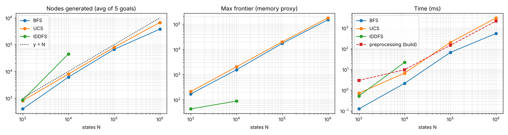

# CSA17 – Artificial Intelligence | Assignment 1 (CO1)
## Design, Analysis and Validation of an Efficient Search Strategy for a Hospital Medicine-Delivery Robot

**Files submitted with this report:** `ai1_search.py` (Tasks 8–9), `ai1_belief.py` (Task 12), `results.json` (raw data), `results.md` (all tables), `belief_out.txt`, `fig_scaling.png`.
**Reproduce:** `python ai1_search.py` then `python ai1_belief.py`. Seeds: graph seed = 2026 + N, goal-selection seed = 2026, belief grid seed = 7, belief trials seeds = 100 + 31·t + k. Timing = mean of 5 runs per (algorithm, goal). All numbers below come from the tables in Appendix A and the Task 12-D table, produced by this code.

---

## TASK 1 – Agent and algorithm design

### 1.1 PEAS and environment classification

| | Description |
|---|---|
| **P**erformance | Medicine reaches the correct ward; minimum total travel time; no collisions; medicine not delayed; low energy; route computed within the planning deadline |
| **E**nvironment | Multi-block hospital: junctions, corridors, lifts, ward doors, people, other trolleys |
| **A**ctuators | Drive wheels, steering, lift-call/door-open interface, drawer lock, speaker/display |
| **S**ensors | LIDAR, camera, wheel odometry, beacon/RFID/Wi-Fi localisation, pharmacy ID reader |

| Property | Choice (for the route-planning abstraction) | Justification |
|---|---|---|
| Observable | **Fully** (original); **partially** after Day-4 fault | The map and the robot's junction are known to the planner; Task 12 removes the second part |
| Deterministic | **Deterministic** | Taking an edge deterministically ends at its other end; people/obstacles are handled by a low-level reactive layer, not the route planner |
| Episodic/Sequential | **Sequential** | Each move changes the position and the cost still to pay; choices are not independent |
| Static/Dynamic | **Static** (semi-dynamic in reality) | The map does not change while the route is computed; if a corridor closes we re-plan |
| Discrete/Continuous | **Discrete** | Locations and edges form a finite graph; continuous motion is handled below the planner |
| Agents | **Single-agent** | Other robots and people are treated as part of the environment, not as adversaries/co-planners |

### 1.2 View of AI, rationality and history
The robot follows **acting rationally**: it is a *goal-based, problem-solving agent* that chooses the action sequence expected to maximise its performance measure (minimum travel time to the requested ward) given what it perceives. It is rational because (i) its performance measure is explicit, (ii) it uses all the knowledge it has (the map, its position) and (iii) it picks an action sequence with provably minimal cost when UCS is used. We do not claim it *thinks* humanly or *acts* humanly — only that its behaviour is optimal for the measure.
Route finding in a graph is the classic early AI problem-solving task: state-space search was central in Newell & Simon's Logic Theorist/General Problem Solver (1956–59), and the robot *Shakey* (1960s) planned routes through rooms and corridors, which motivated the cost-based search later formalised as A*. Our robot is a modern, scaled-up Shakey problem.

### 1.3 Problem formulation
* **States:** a location ℓ ∈ V (junction, corridor point, lift, ward door); |V| = 10³ … 10⁶⁺.
* **Initial state:** the pharmacy node (node 0 in experiments).
* **Actions(s):** go(s,t) for every t with (s,t) ∈ E.
* **Transition model:** Result(s, go(s,t)) = t.
* **Goal test:** s = requested ward g.
* **Path cost:** sum of travel times w(s,t) (integer minutes 1…9 in the experiments, so ε = 1).

### 1.4 Three meaningfully different uninformed strategies

| # | Strategy | Style | Frontier | Key property | Why chosen |
|---|---|---|---|---|---|
| A | **Breadth-first search (BFS)** | **Iterative**, FIFO queue | queue | fewest *moves*, complete | Baseline; cheapest per-node work; optimal only if edge costs are equal |
| B | **Uniform-cost search (UCS)** | **Iterative**, priority queue | min-heap on g(n) | least *travel time*, complete, optimal | The robot's objective is time, not hops |
| C | **Iterative-deepening DFS (IDDFS)** | **Recursive** (depth-limited DFS repeated with L = 0,1,2,…) | the recursion stack | O(b·d) memory, complete, optimal in hops | The memory-lean alternative, to test whether memory (not time) is the bottleneck |

These differ in frontier discipline (FIFO / priority / stack), in the quantity they are optimal for (hops / cost / hops), and in memory behaviour (Θ(b^d) / Θ(b^{C*/ε}) / Θ(bd)).

**Preprocessing (all three):** build adjacency lists from the edge list, Θ(V+E) time and space (measured in Appendix A). BFS and UCS keep an *explored/visited hash set* (O(1) expected lookup, Θ(V) space) so each state is expanded once. IDDFS deliberately keeps only an **on-path set** (cycle check), so its memory stays O(bd); the price is that it cannot detect duplicates reached through *different* paths (important later).

**Pseudocode**

```
BFS(adj, s, g):                         # iterative
  if s == g: return [s]
  parent[s] = None; frontier = Queue(s)
  while frontier not empty:
     u = frontier.pop_front()                        # EXPAND
     for (v,w) in adj[u]:                            # GENERATE successors
        if v not in parent:
           parent[v] = u
           if v == g: return path(parent, v)         # goal test at generation
           frontier.push_back(v)
  return FAILURE

UCS(adj, s, g):                         # iterative
  dist[s]=0; parent[s]=None; pq = MinHeap{(0,s)}; done = {}
  while pq not empty:
     (d,u) = pq.pop_min()
     if u in done: continue                          # stale entry
     done.add(u)                                     # EXPAND
     if u == g: return path(parent, u)               # goal test at expansion (needed for optimality)
     for (v,w) in adj[u]:
        if v not in dist or d+w < dist[v]:
           dist[v]=d+w; parent[v]=u; pq.push((d+w, v))
  return FAILURE

IDDFS(adj, s, g):                       # recursive
  for L = 0,1,2,...:
     cutoff = False; r = DLS(s, L)
     if r found: return r
     if not cutoff: return FAILURE                   # whole component searched, no goal
DLS(u, L):
  if u == g: return [u]
  if L == 0: (cutoff = True if u has an off-path neighbour); return none
  for (v,w) in adj[u]: if v not in onpath:
       onpath.add(v); r = DLS(v, L-1); onpath.remove(v)
       if r: return [u] + r
  return none
```

---

## TASK 2 – Basic operation

| Algorithm | Basic operation | Where | Why appropriate | How its count changes as the hospital grows |
|---|---|---|---|---|
| BFS | **Successor generation with explored-set test + frontier insertion** (the inner `for (v,w)` body) | Inside the expansion loop | It is the most frequently executed statement and every other cost (goal test, parent write) is proportional to it | Number of generations ≤ 2E = Θ(V); with b_eff ≈ 1.9 and d ≈ log_{b}N it grows ∝ N (measured α = 0.99) |
| UCS | **Frontier insertion = heap push** (and its mate, heap pop) | The relaxation `pq.push` | Each push/pop costs Θ(log |frontier|), so it dominates the per-node work | Pushes ≈ nodes with g ≤ C*; grows with C*/ε, i.e. with the *cost-diameter*, not just the hop depth (measured α = 0.97 in nodes, 1.21 in time → the log factor) |
| IDDFS | **Node visit (call of DLS) = expansion**, counted over *all* iterations | Entry of the recursive call | Every iteration re-visits the shallow levels, so total visits, not only the last iteration, determine time | Σ_{L≤d} (visits of depth-L search); grows ~b^d and, on graphs with cycles, with the number of *simple paths*, not states (measured α = 1.72 from 10³→10⁴; budget exceeded beyond) |

---

## TASK 3 – Time and space complexity (derivations)

**Notation.** b = branching factor, d = depth of shallowest goal, m = maximum depth, C* = optimal cost, ε = minimum edge cost (here 1), V, E = states, edges. Uniform tree model for the exponential bounds, then the graph-search bound.

### BFS
Nodes at depth i: bᶦ. Worst case (goal is the last node at depth d), generated nodes
N_gen = 1 + b + b² + … + bᵈ = (b^{d+1} − 1)/(b − 1) = O(bᵈ).
Expanded nodes: Σ_{i=0}^{d−1} bⁱ = (bᵈ − 1)/(b − 1). Frontier at its peak holds a whole level, bᵈ. **Time O(bᵈ), space O(bᵈ).**
With the explored set each state is expanded once, so the bound tightens to **O(min(bᵈ, V + E))**.
**Preprocessing** Θ(V + E). **Total** T = Θ(V+E) + O(min(bᵈ, V+E)) = Θ(V+E): preprocessing is of the same order as the worst-case search, so it must be amortised over many requests.

### UCS
UCS expands every node with g(n) ≤ C*. Each edge costs ≥ ε, so such nodes have depth ≤ ⌊C*/ε⌋ and are at most Σ_{i=0}^{1+⌊C*/ε⌋} bⁱ = O(b^{1+⌊C*/ε⌋}). Each push/pop is O(log F) with F the frontier size:
**Time O(b^{1+⌊C*/ε⌋} · log F)**, **space O(b^{1+⌊C*/ε⌋})**. Note it can be much worse than bᵈ when many cheap edges form a detour (C*/ε ≫ d). On a graph with the explored set: **O((V+E) log V)** time, Θ(V) space. Preprocessing Θ(V+E); total Θ((V+E) log V).

### IDDFS
Level j is generated once in every iteration with limit L ≥ j, i.e. (d − j + 1) times:
N_ID = Σ_{j=0}^{d} (d − j + 1) bʲ = bᵈ Σ_{k=0}^{d} (k+1) b^{−k} < bᵈ (b/(b−1))².
(For b = 2: N_ID = 2^{d+2} − d − 3 versus BFS 2^{d+1} − 1, i.e. ≈ 2× BFS; for b = 10 only ≈ 1.1×.) **Time O(bᵈ)**. Space: one path plus its pending siblings, **O(b·d)** (O(d) if children are produced lazily). Preprocessing Θ(V+E) (adjacency lists); no explored set.
**Caveat that matters here:** IDDFS with only an on-path check counts *paths*. On a graph with cycles the number of simple paths of length ≤ d can be far larger than V, so the tree bound is optimistic. This is verified experimentally in Task 10.

---

## TASK 4 – Best, average and worst case

| | BFS | UCS | IDDFS |
|---|---|---|---|
| **Best** | Goal is the first successor of the start: 2 generations, 1 expansion, O(1). Measured: **2 generated at every N** | Goal edge is *not* automatically the cheapest: UCS must first expand every node with g < cost of that edge. The pharmacy is a high-degree hub, so UCS expanded 5–152 nodes (14–502 generated). Best case is O(b^{1+⌊w/ε⌋}), not O(1) | Goal at depth 1 is found in iteration L = 1: 3 visits. Measured **3 at every N** |
| **Average** | Goal at a typical depth; explores all shallower levels and part of level d: 38 % of states at 10⁶ | Explores all states cheaper than the goal: 67 % of states at 10⁶ (more than BFS because cost-order ignores hop depth) | Σ over iterations; ≈ 7× BFS at 10⁴ states because cycles create many paths; budget exceeded for some goals from 10⁵ states |
| **Worst** | Goal in the last level, or **unreachable**: whole component, V generations (10⁶ at N = 10⁶) | Goal costliest/farthest or unreachable: all V states + stale heap entries (V + 2.4 % extra pushes at 10⁶) and a log factor | Goal at maximum depth or **unreachable**: all simple paths of the component up to the cutoff: exceeded the 10⁶-node budget in every unreachable case, even for 1,005 states |

Why: BFS/UCS never revisit a state, so their worst case is capped by Θ(V + E); IDDFS has no such cap, so a goal that is far away, or absent, makes the number of nodes generated explode. UCS differs from BFS only in *which* nodes are cheap, so its best/average cases depend on the weight distribution, not only on hop depth. (Appendix A, sections "best", "average", "worst-reachable", "unreachable".)

---

## TASK 5 – Asymptotic analysis

| | Time | Memory |
|---|---|---|
| BFS | Θ(min(bᵈ, V+E)) = O(V) | Θ(min(bᵈ, V)) |
| UCS | O((V+E) log V) | Θ(V) |
| IDDFS | Θ(bᵈ) on trees; Ω(#simple paths) on graphs with cycles | Θ(bd) |

As V grows from 10³ to 10⁶, d grows only like log V (farthest ward: 11, 17, 19, 22 hops), because the effective branching factor b_eff = V^{1/d} ≈ 1.9. So bᵈ ≈ V for BFS/UCS: **both are linear in V in nodes** (α ≈ 1), UCS carrying an extra log V (and a constant ≈ 2–5× in Python). IDDFS memory grows only logarithmically (max pending siblings 44 → 165) while its time becomes super-linear.
**Which limit is hit first?** For the hospital robot, *time* limits IDDFS first (budget gone at ≤10⁴ states in the worst/unreachable cases) whereas BFS/UCS are limited by *memory* only far later: their max frontier is ≈ 0.19 V (BFS) and 0.2 V (UCS) → 1.9·10⁵ entries at 10⁶ states, a few tens of MB in Python, so memory becomes the binding constraint around 10⁷–10⁸ states on a typical onboard computer, long after 10⁶ states are comfortably solved in 2–6 s. So: the robot should not use the memory-saving algorithm, because the time penalty of losing the explored set appears long before BFS/UCS memory becomes a problem.

---

## TASK 6 – Recurrence relation (recursive approach: depth-limited search inside IDDFS)

Let T(l) = number of basic operations (node visits plus the work around them) of `DLS(u, l)` when the remaining depth is l.
* **Problem size:** remaining depth l (original problem: l = L, the iteration limit).
* **Subproblem size:** l − 1 (each child is searched with one less level).
* **Number of recursive calls:** one per successor not on the path ⇒ b (worst case, no goal found).
* **Work outside the calls:** the goal test, the loop over b successors, and an on-path membership test for each: a·b + c, with constants a, c.
* **Base case:** l = 0: goal test and cutoff test, T(0) = c₀ = Θ(1).

Therefore
**T(l) = b · T(l − 1) + (a·b + c),  T(0) = c₀.**
For the whole iterative-deepening run: **T_ID(d) = Σ_{l=0}^{d} T(l)** (iteration l calls DLS with limit l).

---

## TASK 7 – Solving the recurrence

**Method.** The recurrence has the form T(l) = b·T(l−1) + f with a *decrement* (l → l−1), not a division, so the Master theorem does not apply; **iteration (unrolling)** works and is then checked by substitution (induction).

Let k = a·b + c. Unrolling:
T(l) = b·T(l−1) + k
 = b²T(l−2) + k(b + 1)
 = …
 = bˡ T(0) + k (bˡ − 1)/(b − 1).
**Check by induction.** Claim T(l) = bˡ c₀ + k(bˡ−1)/(b−1). l = 0: c₀ ✓. If true for l−1, then b·T(l−1) + k = bˡ c₀ + k(bˡ − b)/(b−1) + k = bˡ c₀ + k(bˡ − 1)/(b−1) ✓.
Hence **T(l) = Θ(bˡ)** (recursion-tree view: level j has bʲ nodes each doing Θ(1) outside work, and the geometric sum is dominated by the last level).
**Interpretation.** Time multiplies by b per extra level of depth; raising b to b + 1 multiplies the work by ((b+1)/b)^l — for our b_eff ≈ 1.9 and d = 22 that is ≈ 1.5²² ≈ 10⁴. Depth-limited search alone is exponential regardless of the graph's size V.
**Extension to IDDFS.** T_ID(d) = Σ_{l=0}^{d} [bˡ c₀ + k(bˡ − 1)/(b−1)] = (c₀ + k/(b−1)) (b^{d+1} − 1)/(b−1) − k(d+1)/(b−1) = **Θ(bᵈ)**. The repeated iterations cost only a constant factor b/(b−1) over the last iteration (≈ 2 for b = 2, 1.1 for b = 10): the last level dominates. *The recurrence counts calls on a tree.* On our cyclic hospital graph the number of calls is the number of simple paths, so the measured count exceeds the model — see Task 10.

---

## TASK 8 – Implementation and testing
Code: `ai1_search.py` (BFS, UCS, recursive IDDFS exactly as in the pseudocode of Task 1).
**Test graphs:** random recursive tree (corridor backbone with hubs = lift lobbies) + 10 % extra cross-links, weights 1–9 min, plus an isolated 5-ward block. Sizes 1,005 / 10,005 / 100,005 / 1,000,005 states, same graph and same start/goal pairs for all algorithms; seeds listed at the top.
**Test cases per size:** best (goal adjacent to pharmacy), average (5 random wards in the newer wing), worst-reachable (farthest ward), **unreachable** (island block), **start = goal**.
**Correctness checks built into the code:** every route is verified edge by edge (`path_cost` raises if an edge is missing); start/end checked; optimal cost reference = UCS; optimal-hops reference = BFS; unreachable ⇒ no route (or budget exceeded for IDDFS), start = goal ⇒ path `[s]`, cost 0. IDDFS has a 10⁶-generation budget; exceeding it is reported as **DNF**, never as "no route".
**Expected vs actual:** BFS and IDDFS always returned the minimum number of hops; UCS always returned the minimum cost (cost-optimal = True in every row); start = goal returned depth 0 and cost 0 for all algorithms and sizes; unreachable returned *no route* for BFS and UCS at all sizes and DNF for IDDFS. (Appendix A.)

---

## TASK 9 – Experimental performance
All metrics (nodes generated/expanded, max frontier, depth, cost, optimality, time over 5 runs, preprocessing time) are in Appendix A. Graphs: `fig_scaling.png` (log–log).



Key rows (average case, 5 wards):

| N | BFS gen | UCS gen | IDDFS gen | BFS frontier | UCS frontier | IDDFS stack | BFS ms | UCS ms | IDDFS ms |
|---|---|---|---|---|---|---|---|---|---|
| 1,000 | 398 | 806 | 850 | 171 | 214 | 44 | 0.1 | 0.7 | 0.5 |
| 10,000 | 6,117 | 7,944 | 44,976 | 1,562 | 2,040 | 89 | 2.2 | 6.7 | 22.3 |
| 100,000 | 66,928 | 79,969 | 449,703 (some goals DNF) | 17,336 | 19,955 | 130 | 66 | 202 | 522 |
| 1,000,000 | 381,227 | 672,440 | 854,964 (some goals DNF) | 150,022 | 178,517 | 165 | 546 | 3,079 | 1,316 |

Path cost (average case, 10⁴): BFS 51.6 min, UCS 42.4 min (UCS 18 % faster for the delivery, with 1 extra hop).

---

## TASK 10 – Theory versus experiment
* **Growth of nodes generated.** Theory: O(bᵈ) tree, capped at Θ(V+E) on graphs. With d ∝ log V, bᵈ ≈ V. Observed exponents α = 0.99 (BFS) and 0.97 (UCS): the linear cap is what the data show. The farthest-ward cases generate ≈ V nodes (10⁶ at 10⁶ states), the theoretical worst case.
* **Frontier.** Theory: BFS/UCS Θ(bᵈ) ⇒ Θ(V). Observed α = 0.98/0.97, ≈19 %/20 % of V. IDDFS theory: O(bd) with d ∝ log V; observed 44 → 165 over three decades (α = 0.31, i.e. logarithmic growth). ✔
* **Which scales better?** BFS in both nodes (1.8× fewer than UCS at 10⁶) and time (5.6×), UCS if cost matters (BFS paths are up to 22 % costlier at 10⁴); IDDFS has the best memory but the worst time.
* **Differences and reasons.**
  1. *IDDFS vs the recurrence.* The recurrence predicts only ≈ b/(b−1) ≈ 2× BFS; observed 7× (average, 10⁴) and **≥ 10⁶ nodes** (DNF) for the farthest ward at 10⁴ states, where BFS needs 10⁴. Cause: the graph has cycles, and IDDFS only checks the current path, so one state is reached through many paths; the recurrence models a tree (**duplicates**). For an unreachable goal IDDFS must enumerate all simple paths (exceeded budget even for 1,005 states), so it cannot give a result.
  2. *UCS vs BFS in time.* UCS generates 1.8× BFS nodes at 10⁶ but is 5.6× slower: heap operations are Θ(log F) and heap tuples are costlier than deque appends (the log factor + **language overhead**). Time exponent 1.21 for both > 1.0 as the explored dictionary no longer fits in cache (memory-hierarchy effect, not in the model).
  3. *UCS best case.* Theory says "O(1) if the goal is adjacent"; UCS expanded up to 152 nodes because it first exhausts all cheaper nodes (**tie-breaking/hub degree**).
  4. *Stale heap entries* (lazy deletion) add 2.4 % extra pushes at 10⁶: not in the clean model.
  5. *Preprocessing.* Build time 0.15 s → 2.16 s from 10⁵ → 10⁶ states (α ≈ 1.16, linear within memory effects), comparable to one worst-case BFS (2.3 s): negligible when amortised across many deliveries, not negligible for one-off queries.

---

## TASK 11 – Recommended final design
**Recommendation: Uniform-cost search over precomputed adjacency lists with an explored set (graph-search UCS), plus a one-time connected-component labelling.**
* **Why not IDDFS?** Lowest memory (≈ 165 pending entries) but memory is not the bottleneck: BFS/UCS use ≈ 2·10⁵ frontier entries at 10⁶ states. It failed the 10⁶-node budget for the farthest ward at 10⁴ states and for *every* unreachable query. A robot must also answer "that ward cannot be reached".
* **Why not BFS?** Fastest, but minimises hops, not minutes: at 10⁴ states its routes cost 51.6 vs 42.4 min (+22 %), and it is cost-optimal only by chance (False in all average-case rows).
* **UCS evidence:** cost-optimal in every test; terminates on unreachable goals (explores all V states and reports no route); 0.7 ms (10³), 6.7 ms (10⁴), 202 ms (10⁵), 3.1 s (10⁶) on average, up to 5.6–6.4 s worst case/unreachable in pure Python; theory O((V+E) log V).
* **Trade-offs and limits:** 1.8× the nodes and 5.6× the time of BFS at 10⁶; Θ(V) memory; preprocessing Θ(V+E) (2.2 s at 10⁶, paid once per map change).
* **Improvement (proposed, not measured):** run a union–find/BFS pass at map-build time (Θ((V+E)α(V))) to label connected components. Unreachable requests then cost O(1) instead of exploring all V states (6.4 s at 10⁶), and UCS runs only on reachable requests. Beyond ~10⁷ states, or for tight deadlines, uninformed search stops being practical and a heuristic search (A*) with landmarks should replace it (Assignment 2's topic).
* **Practical as the hospital grows?** Yes up to ≈ 10⁶–10⁷ states (seconds in Python, much faster in compiled code); the growth is near-linear.

---

## TASK 12 – Day-4 design challenge: the robot does not know where it is

### A. Impact analysis (2)
*Changed:* the start state is no longer known, so the initial state becomes a **set** of k possible junctions; the environment becomes **partially observable**. Original assumptions broken: *fully observable* and *known start state*. The effect of an action depends on the true location, which the robot cannot see, so what it **knows** determines which action sequences are guaranteed to work: the robot's knowledge (a **belief state** = set of possible junctions) must be part of the state. The goal test becomes "belief ⊆ {dock}" (certain to be at the dock).

### B. Evaluation of the original design (2)
Applying the original algorithm to *one guessed* start fails: following the shortest path of the first candidate location reaches the dock for only **50 % (k = 2), 25 % (k = 4), 12 % (k = 8)** of the possible true locations — roughly 1/k (table in 12-D). Retaining it unchanged is **not acceptable**.
It can be applied only if "state" is redefined as a belief state. A belief is a subset of V, so the space has 2^V − 1 states; actions never enlarge a belief, so from a start belief of size k the reachable beliefs number at most Σ_{j≤k} C(V, j) ≈ V^k/k!. With V = 64: 2,080 (k=2), 679,120 (k=4), 5.13·10⁹ (k=8). With V = 10⁶ even k = 3 gives ≈ 1.7·10¹⁷. The *state* space has multiplied by roughly V^{k−1}/k!, so the original BFS over single states is replaced by something exponentially larger in k.

### C. Adaptation (2): MODIFY, not redesign from scratch
1. **Without a sensor:** the original BFS runs unchanged *on belief states* (state = frozenset of junctions; Result(B, a) = {Result(s,a) : s ∈ B}; goal belief = {dock}). It returns a fixed, conditional-free plan that works for every possible start. Cost: O(Σ_{j≤k} C(V,j)) belief states worst case.
2. **With the local sensor (corridor-opening percept):** AND–OR search. After every action the percept splits the belief into classes (AND over percepts, OR over actions), found by iterative deepening on the worst-case plan length. **As soon as the belief becomes a single junction the robot has localised and hands over to the original, retained shortest-path / UCS design.** So the original algorithm is *kept for the second stage*; only a localisation stage is added.
3. Complexity effect: without a sensor, belief growth ~V^k/k!; with the sensor, each action only splits a belief into ≤ 2⁴ = 16 percept classes, and the beliefs actually generated stay tiny (below).

### D. Evidence-based defence (2) – code `ai1_belief.py`, grid 8×8 (V = 64), 10 random start beliefs for each k

grid 8x8, V = 64 , max localised distance to dock = 14 hops
Theory: reachable belief states <= sum_{j<=k} C(64,j) (actions never grow a belief)

| k | trials | naive-plan success | blind: beliefs generated | blind: plan len | sensor: beliefs generated | sensor: worst-case plan len | k=1 single-state BFS len | bound sum_{j<=k}C(64,j) |
|---|---|---|---|---|---|---|---|---|
| 2 | 10 | 50% | 1396.2 (10/10 solvable) | 11.2 | 3.2 (10/10) | 9.9 | 9.9 (max single dist) | 2,080 |
| 4 | 10 | 25% | 86797.7 (10/10 solvable) | 10.7 | 11.0 (10/10) | 9.1 | 9.1 (max single dist) | 679,120 |
| 8 | 10 | 12% | n/a (0/10 solvable) | n/a | 43.2 (10/10) | 12.0 | 12.0 (max single dist) | 5,130,659,560 |

Worked example k=4: possible junctions [2, 13, 56, 62]
blind (no sensor) shortest conditional-free plan: SWWNNNNNWWNWWN  length 14
with sensor: worst-case plan length 13


* **Prediction (before running):** blind BFS will blow up with k (bound V^k/k!); the sensor will collapse the belief set after a few moves; the plan length with sensing will be close to the original single-state distance.
* **Result:** generated belief states: **1,396 → 86,798 → cap exceeded (> 400,000) for k = 8 without a sensor**, matching the bound's growth (≈ 67 % and 13 % of the bound for k = 2 and 4). With the sensor: **3.2 → 11.0 → 43.2**, i.e. orders of magnitude fewer, and the worst-case plan length (9.9, 9.1, 12.0 moves) **equals the longest single-state distance to the dock** in these trials, so on this grid localisation costs no extra moves in the worst case. Without a sensor the plan must be long enough to work from *all* starts at once (10.7–11.2 moves for k = 2, 4; unsolvable within the cap for k = 8).
* **Decision:** MODIFY — belief-state AND–OR search for localisation + original UCS for the last leg. Keep it only for small k or when a local sensor exists; if k is large and there is no sensor, the blind belief search is infeasible and the robot should first run a cheap sensor-reset procedure (e.g. drive to the nearest wall/known landmark) rather than plan over beliefs.
* **Limitations:** one grid (seed 7), 10 trials per k, actions that bump into walls stay in place; the "free localisation" result is specific to this sensor and map.

---

## Threats to validity (honest limitations)
Python timings are machine- and language-dependent, so operation counts are the primary evidence; one graph per size; weights 1–9 give ε = 1; IDDFS is stopped at 10⁶ generations; the average case uses 5 random wards.

## Appendix A – Full experimental tables (`results.md`)
### Preprocessing (adjacency-list construction; graph seed = 2026+N)

| N | states V | edges E | build time (s) | farthest ward (hops) |
|---|---|---|---|---|
| 1,000 | 1,005 | 1,103 | 0.00 | 11 |
| 10,000 | 10,005 | 11,003 | 0.01 | 17 |
| 100,000 | 100,005 | 110,003 | 0.15 | 19 |
| 1,000,000 | 1,000,005 | 1,100,003 | 2.16 | 22 |

### Case: best (goal adjacent to pharmacy)

| N | algo | result | generated | expanded | max frontier | depth | cost | cost-optimal | hop-optimal | time ms |
|---|---|---|---|---|---|---|---|---|---|---|
| 1,000 | BFS | route | 2 | 1 | 1 | 1.0 | 7.0 | True | True | 0.0 |
| 1,000 | UCS | route | 28 | 10 | 20 | 1.0 | 7.0 | True | True | 0.0 |
| 1,000 | IDDFS | route | 3 | 3 | 8 | 1.0 | 7.0 | True | True | 0.0 |
| 10,000 | BFS | route | 2 | 1 | 1 | 1.0 | 4.0 | True | True | 0.0 |
| 10,000 | UCS | route | 14 | 5 | 10 | 1.0 | 4.0 | True | True | 0.0 |
| 10,000 | IDDFS | route | 3 | 3 | 6 | 1.0 | 4.0 | True | True | 0.0 |
| 100,000 | BFS | route | 2 | 1 | 1 | 1.0 | 9.0 | True | True | 0.0 |
| 100,000 | UCS | route | 502 | 152 | 361 | 1.0 | 9.0 | True | True | 0.2 |
| 100,000 | IDDFS | route | 3 | 3 | 19 | 1.0 | 9.0 | True | True | 0.0 |
| 1,000,000 | BFS | route | 2 | 1 | 1 | 1.0 | 9.0 | True | True | 0.0 |
| 1,000,000 | UCS | route | 290 | 75 | 217 | 1.0 | 9.0 | True | True | 0.1 |
| 1,000,000 | IDDFS | route | 3 | 3 | 13 | 1.0 | 9.0 | True | True | 0.0 |

### Case: average (5 random wards)

| N | algo | result | generated | expanded | max frontier | depth | cost | cost-optimal | hop-optimal | time ms |
|---|---|---|---|---|---|---|---|---|---|---|
| 1,000 | BFS | route | 398 | 227 | 171 | 5.6 | 34.8 | False | True | 0.1 |
| 1,000 | UCS | route | 806 | 644 | 214 | 6.4 | 33.8 | True | False | 0.7 |
| 1,000 | IDDFS | route | 850 | 850 | 44 | 5.6 | 34.8 | False | True | 0.5 |
| 10,000 | BFS | route | 6,117 | 4,911 | 1,562 | 9.4 | 51.6 | False | True | 2.2 |
| 10,000 | UCS | route | 7,944 | 6,118 | 2,040 | 10.2 | 42.4 | True | False | 6.7 |
| 10,000 | IDDFS | route | 44,976 | 44,976 | 89 | 9.4 | 51.6 | False | True | 22.3 |
| 100,000 | BFS | route | 66,928 | 54,088 | 17,336 | 10.4 | 56.6 | False | True | 66.3 |
| 100,000 | UCS | route | 79,969 | 64,203 | 19,955 | 11.4 | 47.4 | True | False | 202.4 |
| 100,000 | IDDFS | mixed | 449,703 | 449,703 | 130 | - | - | None | None | 521.5 |
| 1,000,000 | BFS | route | 381,227 | 231,210 | 150,022 | 10.6 | 53.8 | False | True | 545.9 |
| 1,000,000 | UCS | route | 672,440 | 511,427 | 178,517 | 10.8 | 53.6 | True | False | 3078.6 |
| 1,000,000 | IDDFS | mixed | 854,964 | 854,964 | 165 | - | - | None | None | 1316.0 |

### Case: worst-reachable (farthest ward)

| N | algo | result | generated | expanded | max frontier | depth | cost | cost-optimal | hop-optimal | time ms |
|---|---|---|---|---|---|---|---|---|---|---|
| 1,000 | BFS | route | 1,000 | 991 | 232 | 11.0 | 46.0 | True | True | 0.4 |
| 1,000 | UCS | route | 996 | 937 | 224 | 11.0 | 46.0 | True | True | 1.0 |
| 1,000 | IDDFS | route | 20,875 | 20,875 | 75 | 11.0 | 46.0 | True | True | 14.8 |
| 10,000 | BFS | route | 10,000 | 9,998 | 1,827 | 17.0 | 79.0 | False | True | 4.1 |
| 10,000 | UCS | route | 10,239 | 9,991 | 2,040 | 18.0 | 74.0 | True | False | 9.3 |
| 10,000 | IDDFS | DNF(budget) | 1,000,001 | 1,000,000 | 139 | - | - | None | None | 515.7 |
| 100,000 | BFS | route | 100,000 | 99,997 | 19,204 | 19.0 | 102.0 | False | True | 183.2 |
| 100,000 | UCS | route | 102,444 | 99,996 | 20,030 | 20.0 | 91.0 | True | False | 315.2 |
| 100,000 | IDDFS | DNF(budget) | 1,000,001 | 1,000,000 | 145 | - | - | None | None | 1179.2 |
| 1,000,000 | BFS | route | 1,000,000 | 999,994 | 186,580 | 22.0 | 115.0 | False | True | 2330.5 |
| 1,000,000 | UCS | route | 1,024,975 | 999,934 | 201,121 | 22.0 | 101.0 | True | True | 5576.1 |
| 1,000,000 | IDDFS | DNF(budget) | 1,000,001 | 1,000,000 | 170 | - | - | None | None | 1743.9 |

### Case: unreachable (isolated ward block)

| N | algo | result | generated | expanded | max frontier | depth | cost | cost-optimal | hop-optimal | time ms |
|---|---|---|---|---|---|---|---|---|---|---|
| 1,000 | BFS | no route | 1,000 | 1,000 | 232 | - | - | None | None | 0.5 |
| 1,000 | UCS | no route | 1,023 | 1,000 | 224 | - | - | None | None | 1.1 |
| 1,000 | IDDFS | DNF(budget) | 1,000,001 | 1,000,000 | 117 | - | - | None | None | 425.4 |
| 10,000 | BFS | no route | 10,000 | 10,000 | 1,827 | - | - | None | None | 6.0 |
| 10,000 | UCS | no route | 10,240 | 10,000 | 2,040 | - | - | None | None | 12.8 |
| 10,000 | IDDFS | DNF(budget) | 1,000,001 | 1,000,000 | 139 | - | - | None | None | 663.4 |
| 100,000 | BFS | no route | 100,000 | 100,000 | 19,204 | - | - | None | None | 189.3 |
| 100,000 | UCS | no route | 102,445 | 100,000 | 20,030 | - | - | None | None | 320.3 |
| 100,000 | IDDFS | DNF(budget) | 1,000,001 | 1,000,000 | 145 | - | - | None | None | 1094.3 |
| 1,000,000 | BFS | no route | 1,000,000 | 1,000,000 | 186,580 | - | - | None | None | 2276.0 |
| 1,000,000 | UCS | no route | 1,024,989 | 1,000,000 | 201,121 | - | - | None | None | 6413.6 |
| 1,000,000 | IDDFS | DNF(budget) | 1,000,001 | 1,000,000 | 170 | - | - | None | None | 1560.5 |

### Case: start==goal

| N | algo | result | generated | expanded | max frontier | depth | cost | cost-optimal | hop-optimal | time ms |
|---|---|---|---|---|---|---|---|---|---|---|
| 1,000 | BFS | route | 1 | 0 | 1 | 0.0 | 0.0 | True | True | 0.0 |
| 1,000 | UCS | route | 1 | 1 | 1 | 0.0 | 0.0 | True | True | 0.0 |
| 1,000 | IDDFS | route | 1 | 1 | 0 | 0.0 | 0.0 | True | True | 0.0 |
| 10,000 | BFS | route | 1 | 0 | 1 | 0.0 | 0.0 | True | True | 0.0 |
| 10,000 | UCS | route | 1 | 1 | 1 | 0.0 | 0.0 | True | True | 0.0 |
| 10,000 | IDDFS | route | 1 | 1 | 0 | 0.0 | 0.0 | True | True | 0.0 |
| 100,000 | BFS | route | 1 | 0 | 1 | 0.0 | 0.0 | True | True | 0.0 |
| 100,000 | UCS | route | 1 | 1 | 1 | 0.0 | 0.0 | True | True | 0.0 |
| 100,000 | IDDFS | route | 1 | 1 | 0 | 0.0 | 0.0 | True | True | 0.0 |
| 1,000,000 | BFS | route | 1 | 0 | 1 | 0.0 | 0.0 | True | True | 0.0 |
| 1,000,000 | UCS | route | 1 | 1 | 1 | 0.0 | 0.0 | True | True | 0.0 |
| 1,000,000 | IDDFS | route | 1 | 1 | 0 | 0.0 | 0.0 | True | True | 0.0 |

### Empirical growth exponent alpha in metric ~ N^alpha (average case, 1k -> 1M)

| algo | alpha (generated) | alpha (max frontier) | alpha (time) |
|---|---|---|---|
| BFS | 0.99 | 0.98 | 1.21 |
| UCS | 0.97 | 0.97 | 1.21 |
| IDDFS | 1.72 | 0.31 | 1.63 |
