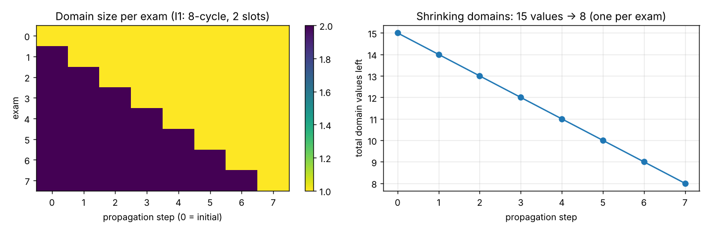

# CSA17 – Artificial Intelligence | Assignment 2 (CO2) — Individual

**Method used throughout: Predict → Design → Implement → Measure → Analyse → Evaluate → Diagnose → Redesign → Validate.**
The predictions were written to `predictions_before_running.md` *before any code was run*, and are compared with the results below, including the ones that turned out wrong.
**Files:** `a2_t1.py … a2_t5.py`, `a2_t6_t7.py`, `a2_t7_adversary.py`, raw outputs `t1_out.txt … t7_adversary_out.txt`, `fig_t5_domains.png`. Run any script with `python <file>`. Seeds are in each file header. Operation counts (expansions, generations, checks, evaluation calls) are the primary evidence; time is secondary.

---

## TASK 1 – Greedy, UCS and A* under different map conditions

### Heuristic and its admissibility
Grid maps, 4-connected moves; road cell cost 1, construction/slow zone cost 5, walls blocked.
**h(n) = |r − r_goal| + |c − c_goal| (Manhattan distance × c_min, with c_min = 1).**
*Relaxed problem:* delete every wall and make every slow cell cost 1. In the relaxed problem the cheapest route is exactly the Manhattan distance, and since removing restrictions can only lower the optimal cost, h(n) ≤ h*(n) for every n ⇒ **admissible**. It is also **consistent**: one move changes h by at most 1 ≤ the move's cost (≥ 1), so A* graph-search with a closed set returns optimal paths.

### Predictions and their algorithmic reasons (made before running)
* **UCS** expands every state cheaper than the goal, in a disc around the start → cost ≈ O(area); insensitive to obstacle layout.
* **Greedy** orders by h only, ignoring g: follows the straight line, fast when the line is clear, but can be led into dead ends and ignores costly cells → expect fewest expansions on open maps, suboptimal when costs differ.
* **A*** ordered by g+h: focuses on the goal direction like Greedy but is optimal; expansions grow when obstacles make the true cost exceed h.
Per-map predictions are listed in `predictions_before_running.md` (T1).

### Designed maps
**M1 open roads** (61×61, 5 % random obstacles) represents the 95 % case; **M2 perfect maze** (61×61, single corridor tree) neutralises the heuristic; **M3 dead-end cup** (a 30-row cup facing the start, goal behind it) is the edge case that should trap Greedy; **M4 swamp band** (21×41 block of cost-5 cells with a cheap way round) is a second edge case where cheapest ≠ straightest.

### Results (code: `a2_t1.py`)
| map | algo | expanded | generated | max frontier | path cost | optimal? | time ms |
|---|---|---|---|---|---|---|---|
| M1 open roads (5% obstacles) | UCS | 3,540 | 3,540 | 63 | 120 | True | 7.8 |
| M1 open roads (5% obstacles) | Greedy | 129 | 281 | 153 | 128 | False | 0.5 |
| M1 open roads (5% obstacles) | A* | 159 | 337 | 179 | 120 | True | 0.4 |
| M2 perfect maze (dead ends) | UCS | 924 | 925 | 5 | 668 | True | 1.3 |
| M2 perfect maze (dead ends) | Greedy | 732 | 744 | 13 | 668 | True | 1.0 |
| M2 perfect maze (dead ends) | A* | 865 | 868 | 5 | 668 | True | 1.3 |
| M3 dead-end cup trap | UCS | 3,640 | 3,646 | 67 | 88 | True | 6.3 |
| M3 dead-end cup trap | Greedy | 924 | 1,031 | 108 | 88 | True | 1.6 |
| M3 dead-end cup trap | A* | 1,400 | 1,510 | 111 | 88 | True | 2.6 |
| M4 swamp band (cost 5) with detour | UCS | 3,649 | 3,703 | 136 | 98 | True | 6.4 |
| M4 swamp band (cost 5) with detour | Greedy | 57 | 170 | 114 | 140 | False | 0.4 |
| M4 swamp band (cost 5) with detour | A* | 1,085 | 1,281 | 197 | 98 | True | 2.1 |

OPEN-ROAD TRIPS: 200 random start/goal pairs on M1 (seed 5)
| algo | mean expanded | % trips optimal | mean cost excess % |
|---|---|---|---|
| UCS | 1,815 | 100.0 | 0.00 |
| Greedy | 43 | 60.0 | 2.49 |
| A* | 54 | 100.0 | 0.00 |

### Prediction vs observation
| Map | Predicted | Observed | Verdict |
|---|---|---|---|
| M1 | A* ≫ fewer than UCS; Greedy fewest, ≈ optimal | UCS 3,540 vs A* 159 expansions (22× fewer); Greedy 129 but cost 128 vs 120 (+6.7 %) | ✔ |
| M2 | all same cost, UCS most expansions | cost 668 for all; expansions UCS 924, A* 865, Greedy 732 | ✔ — in a maze the heuristic barely helps (all within 21 %) |
| M3 | Greedy dives into cup, suboptimal path, A* better | Greedy expanded 924 states (it filled the cup) but its **path was still optimal (88)**; **A\* expanded more (1,400)** than Greedy; UCS 3,640 | ✘ — wrong on two counts. A* must prove no cheaper route exists, so it also fills the cup up to f = 88; Greedy escapes sooner because it only follows h |
| M4 | Greedy through swamp, suboptimal (≈140 vs ≈102); A* optimal | Greedy cost 140 vs optimum 98 (+43 %), 57 expansions; A* 98 with 1,085 (UCS 3,649) | ✔ (optimum 98, not 102) |

**Conclusion of the investigation:** no algorithm should *always* be preferred. UCS is never the best choice here; Greedy wins on effort but loses optimality whenever costs are non-uniform or obstacles force a detour; A* is optimal everywhere and its extra cost over Greedy depends on the map (little on open maps, large when a trap forces it to certify optimality).

### Design decision: 95 % of trips are on open roads
Evidence from 200 random start/goal pairs on an open map (second table above): **A\*: mean 54 expansions, 100 % optimal. Greedy: 43 expansions but only 60 % of trips optimal (mean excess 2.5 %). UCS: 1,815 expansions, 100 % optimal.**
Weighting 95 % open-road trips + 5 % hard maps (mean of M2–M4): expected expansions ≈ A* 107, Greedy 69, UCS 1,861.
**Recommendation: A\*** with the Manhattan heuristic. Versus UCS it is ≈ 17× cheaper while equally optimal. Versus Greedy it costs ≈ 25 % more expansions on open roads (54 vs 43) but removes the 40 % of trips that are suboptimal and the +43 % worst case on cost-asymmetric maps. Greedy would be justified only if a 2.5 % longer route is acceptable and compute is the binding limit.

---

## TASK 2 – When is an online search agent the right choice?

### Setup (`a2_t2.py`)
A rover senses only the 4 neighbouring cells. **Online DFS:** move to an unvisited open neighbour, otherwise backtrack along its own path; failure is declared when the path is empty. **LRTA\*:** keeps H(s), moves to argmin(1 + H(s′)), updates H(s); H persists across missions. Mazes: 21², 41², 81² grids; "braid" = fraction of dead ends removed (0 = perfect maze with many dead ends, 1 = no dead ends, many loops); targets near/mid/far (15 %, 50 %, 100 % of the farthest BFS distance); 5 mazes per setting; **competitive ratio = moves ÷ optimal moves with full map**.

### Predictions (before running)
DFS moves ≈ 2 × cells explored, ratio rising with size, distance and dead-end density; unreachable ⇒ about 2 × reachable cells; LRTA* converges to ratio ≈ 1 within 10–20 missions.

### Results
Online DFS: mean over 5 mazes per cell. size = grid side, braid = fraction of dead ends removed
| grid | braid | dead-end density | open cells | target | optimal | DFS moves | revisits | competitive ratio |
|---|---|---|---|---|---|---|---|---|
| 21x21 | 0.0 | 0.06 | 199 | near | 21 | 21 | 0 | 1.00 |
| 21x21 | 0.0 | 0.06 | 199 | mid | 68 | 70 | 1 | 1.02 |
| 21x21 | 0.0 | 0.06 | 199 | far | 136 | 181 | 22 | 1.33 |
| 21x21 | 0.5 | 0.03 | 204 | near | 12 | 12 | 0 | 1.00 |
| 21x21 | 0.5 | 0.03 | 204 | mid | 39 | 41 | 0 | 1.06 |
| 21x21 | 0.5 | 0.03 | 204 | far | 78 | 197 | 50 | 2.54 |
| 21x21 | 1.0 | 0.00 | 210 | near | 9 | 9 | 0 | 1.00 |
| 21x21 | 1.0 | 0.00 | 210 | mid | 30 | 44 | 1 | 1.48 |
| 21x21 | 1.0 | 0.00 | 210 | far | 60 | 190 | 50 | 3.18 |
| 41x41 | 0.0 | 0.05 | 799 | near | 70 | 72 | 1 | 1.02 |
| 41x41 | 0.0 | 0.05 | 799 | mid | 234 | 269 | 17 | 1.15 |
| 41x41 | 0.0 | 0.05 | 799 | far | 468 | 720 | 126 | 1.54 |
| 41x41 | 0.5 | 0.03 | 818 | near | 32 | 32 | 0 | 1.00 |
| 41x41 | 0.5 | 0.03 | 818 | mid | 106 | 132 | 1 | 1.24 |
| 41x41 | 0.5 | 0.03 | 818 | far | 213 | 693 | 185 | 3.26 |
| 41x41 | 1.0 | 0.00 | 838 | near | 20 | 20 | 0 | 1.00 |
| 41x41 | 1.0 | 0.00 | 838 | mid | 66 | 326 | 92 | 4.98 |
| 41x41 | 1.0 | 0.00 | 838 | far | 131 | 723 | 235 | 5.51 |
| 81x81 | 0.0 | 0.05 | 3199 | near | 239 | 261 | 11 | 1.09 |
| 81x81 | 0.0 | 0.05 | 3199 | mid | 797 | 1097 | 150 | 1.38 |
| 81x81 | 0.0 | 0.05 | 3199 | far | 1593 | 2854 | 630 | 1.79 |
| 81x81 | 0.5 | 0.02 | 3279 | near | 49 | 55 | 3 | 1.12 |
| 81x81 | 0.5 | 0.02 | 3279 | mid | 164 | 1894 | 516 | 11.58 |
| 81x81 | 0.5 | 0.02 | 3279 | far | 327 | 3054 | 1020 | 9.33 |
| 81x81 | 1.0 | 0.00 | 3359 | near | 37 | 1347 | 649 | 36.60 |
| 81x81 | 1.0 | 0.00 | 3359 | mid | 122 | 2474 | 888 | 20.24 |
| 81x81 | 1.0 | 0.00 | 3359 | far | 244 | 1668 | 504 | 6.82 |

Unreachable target (sealed pocket), online DFS:
| grid | braid | reachable cells | moves until failure declared | moves / reachable cells |
|---|---|---|---|---|
| 21x21 | 0.0 | 193 | 384 | 1.99 |
| 21x21 | 1.0 | 204 | 406 | 1.99 |
| 41x41 | 0.0 | 777 | 1552 | 2.00 |
| 41x41 | 1.0 | 833 | 1664 | 2.00 |
| 81x81 | 0.0 | 3193 | 6384 | 2.00 |
| 81x81 | 1.0 | 3349 | 6696 | 2.00 |

LRTA* learning over repeated missions (same maze, far target), moves per trial; optimal = BFS length
| grid | braid | optimal | trial 1 | 2 | 3 | 5 | 10 | 20 | 40 | first trial with ratio<=1.05 |
|---|---|---|---|---|---|---|---|---|---|---|
| 21x21 | 0.0 | 120 | 1160 | 508 | 522 | 888 | 244 | 226 | 128 | none in 40 |
| 21x21 | 0.5 | 98 | 572 | 1502 | 396 | 330 | 228 | 188 | 136 | 29 |
| 41x41 | 0.5 | 206 | 3046 | 1796 | 2532 | 878 | 1148 | 740 | 508 | none in 40 |

Amortisation, 41x41 braid 0.5 far target: total moves over m missions
| missions m | online DFS every time | LRTA* learning | DFS once then stored map (optimal) |
|---|---|---|---|
| 1 | 420 | 3046 | 420 |
| 2 | 840 | 4842 | 626 |
| 5 | 2100 | 9896 | 1244 |
| 10 | 4200 | 16050 | 2274 |
| 40 | 16800 | 41404 | 8454 |

### Analysis
* **Near targets are cheap:** ratio 1.00–1.09 in perfect mazes (braid 0) up to 81×81.
* **Far targets and size:** ratio 1.33 → 1.54 → 1.79 for perfect mazes of 199 → 799 → 3,199 cells.
* **Prediction partly refuted:** I expected *more dead ends* to hurt most. The opposite happened: removing dead ends (braid 1) **raised** the ratio (far target 3.18 → 5.51 → 6.82; one near-target case reached **36.6**: 1,347 moves for an optimal 37). Loops create short routes that the optimal path uses but DFS, which commits to the first unvisited neighbour, does not. The ratio is driven by *loopiness × size*, not by dead-end density.
* **Unreachable target:** moves = 2.00 × reachable cells in all six runs (each cell entered once and left once ⇒ 2(c − 1) moves): predicted ✔. The rover must explore the entire facility before it can say "not here".
* **LRTA\***: trial 1 costs 6–15× the optimum (1,160 vs 120, 3,046 vs 206); the learning curve is *not monotone* (trial 2 of the 21² braid-0.5 maze cost 1,502 after 572) and reaching ≤ 1.05× the optimum took 29 missions in one maze and **more than 40** in two others. Prediction (10–20 missions) ✘ — too optimistic.

### Operating boundary (original question)
An online DFS agent is a reasonable choice when **(i)** no map exists and the facility will be visited once or its layout changes between visits; **(ii)** the facility is small (≲ 10³ cells) or loop-free: measured ratios ≤ 1.8 for perfect mazes even at 3,199 cells; **(iii)** the target is not at the far end and the battery can pay up to 2× the facility's cell count in the worst case. **Stop recommending it** when the facility has many loops and more than a few hundred cells (ratios 3–36 observed), when "target absent" must be decided cheaply (cost 2 × all cells), or when the same facility is visited repeatedly. LRTA* should not be chosen for repeated missions unless tens of missions are expected: its cumulative cost over 40 missions (41,404 moves) was *higher* than running online DFS every time (16,800).

### Changed condition: 20 rovers, 20 facilities, maps unchanged for months
The recommendation changes. The cost of exploring is now paid **once per facility** and amortised over months of missions (last table): over 40 missions, *explore once with DFS, then plan on the stored map* needs 8,454 moves versus 16,800 (DFS every time) and 41,404 (LRTA*), i.e. 2× and 4.9× less, and every later mission has competitive ratio 1.0. Revised design: online DFS only as a **mapping mission** (and for re-mapping when a stored map is found to be wrong), followed by A*/BFS on the stored map; per-facility map storage is O(cells), trivial next to the fuel saved. LRTA* is dropped. Caveat: this assumes the map really is static and the rover can detect a blocked route and fall back to online mode.

---

## TASK 3 – Engineering the behaviour of alpha-beta pruning

### Designed trees (`a2_t3.py`)
Uniform trees (b, d) = (4, 6), (3, 8), (5, 5), root = MAX, distinct random leaf values (seed 7).
1. **Many cutoffs:** at every node children are sorted so the best move for the player to move comes first.
2. **Almost no cutoffs (engineered):** the same tree with every node's children sorted worst-move-first.
3. **Own conditions:** (a) all leaves equal; (b) random child order, 100 shuffles.
*Prediction formula* for best ordering: nodes at level ℓ = b^⌈ℓ/2⌉ + b^⌊ℓ/2⌋ − 1, total = Σℓ; for (4,6): 1+4+7+19+31+79+127 = **268**. Worst: no cutoffs ⇒ all (bᵈ⁺¹−1)/(b−1) = **5,461**. Random: leaves ≈ b^{3d/4} (≈ 512). Equal leaves: pruning condition α ≥ β is met on ties ⇒ same as best-case count.

### Results
| b | d | test | minimax nodes | PREDICTED a-b nodes | a-b nodes | a-b leaves | cutoffs | a-b/minimax |
|---|---|---|---|---|---|---|---|---|
| 4 | 6 | 1 best ordering | 5,461 | 268 | 268 | 127 | 99 | 0.049 |
| 4 | 6 | 2 worst ordering | 5,461 | 5,461 | 4,785 | 3,516 | 696 | 0.876 |
| 4 | 6 | 3a all leaves equal | 5,461 | 268 | 268 | 127 | 99 | 0.049 |
| 4 | 6 | 3b random ordering (100 shuffles): mean | 5,461 | leaves≈b^(3d/4)=512 | 1,457 | 939 | 322 | 0.267 |
| 4 | 6 | 3b random ordering: min / max nodes | | | 820 / 2,074 | | | |
| 3 | 8 | 1 best ordering | 9,841 | 393 | 393 | 161 | 152 | 0.040 |
| 3 | 8 | 2 worst ordering | 9,841 | 9,841 | 7,864 | 5,089 | 1,469 | 0.799 |
| 3 | 8 | 3a all leaves equal | 9,841 | 393 | 393 | 161 | 152 | 0.040 |
| 3 | 8 | 3b random ordering (100 shuffles): mean | 9,841 | leaves≈b^(3d/4)=729 | 2,143 | 1,202 | 543 | 0.218 |
| 3 | 8 | 3b random ordering: min / max nodes | | | 1,144 / 3,428 | | | |
| 5 | 5 | 1 best ordering | 3,906 | 242 | 242 | 149 | 56 | 0.062 |
| 5 | 5 | 2 worst ordering | 3,906 | 3,906 | 3,617 | 2,862 | 355 | 0.926 |
| 5 | 5 | 3a all leaves equal | 3,906 | 242 | 242 | 149 | 56 | 0.062 |
| 5 | 5 | 3b random ordering (100 shuffles): mean | 3,906 | leaves≈b^(3d/4)=418 | 986 | 707 | 162 | 0.252 |
| 5 | 5 | 3b random ordering: min / max nodes | | | 461 / 1,636 | | | |

Same b=4, d=6 (4,096 leaves): alpha-beta leaf evaluations range from 127 (best order) to 3516 (worst order): factor 27.7

### Prediction vs result
* **Best order:** 268 / 393 / 242 nodes — **exactly equal to the formula** in all three trees (94–96 % fewer nodes than minimax).
* **All leaves equal:** identical to the best-order counts ✔: with ties every sibling after the first is cut as soon as its first child returns a value already ≥ β (or ≤ α), so equal values behave like perfect ordering.
* **Worst order:** predicted 5,461 (no cutoffs) but observed **4,785** nodes with **696 cutoffs** (b=4, d=6; 12 % saved). ✘ Partly wrong. Sorting *each node's children by their own value* is not the global worst case: α and β handed down from ancestors involve values of *cousin* subtrees, so some deep nodes still get cut. A truly cutoff-free tree needs the ordering to be consistent with the bounds of every ancestor, which local sorting does not guarantee. Still, leaf evaluations were 3,516 vs 127 for the best order: **27.7×** more work for the same b and d.
* **Random order:** mean 1,457 nodes (939 leaves; range 820–2,074 nodes). The b^{3d/4} formula (512 leaves) underestimates by ≈ 1.8×: it is an asymptotic result for large b, and with b = 4 the constants matter.

### Why the work differs and what this reveals
A cutoff needs a *bound that is already as good as the value the current subtree could offer*. Trying the best move first at each MAX node, and the strongest reply first at each MIN node, makes α and β tight after the first branch, so every later sibling is refuted by a single reply. Examining the worst move first leaves α/β loose, so each sibling must be explored fully before it is rejected. Effective branching factor is therefore about √b (best), ≈ b^{3/4} (random), and ≈ b (worst). **Branching factor and depth alone do not determine alpha-beta's cost**: with b = 4, d = 6 the same algorithm evaluated between 127 and 3,516 leaves. An engine's performance depends on move-ordering quality (e.g. killer moves, previous-iteration best move first), which is why b and d must be accompanied by ordering statistics.

---

## TASK 4 – Minimax and the cost of examining every possibility

### Design (`a2_t4.py`)
Game: gravity "Connect-k" on 4×4 (k = 3, b = 4), 5×5 (k = 4, b = 5) and 6×7 (k = 4, b = 7). Depth-limited minimax; at depth 0 (or full board) the **evaluation function** is applied: for every length-k window that contains no enemy disc, add 10^(own discs − 1) for the maximising player, subtract the same for the opponent, plus +2 per own disc in the centre column. A won position is scored ±100,000 (±depth bonus to prefer quick wins) and is not counted as an evaluation call.
### Derivation
Positions examined at lookahead depth d with constant branching b: 1 + b + … + bᵈ = (bᵈ⁺¹ − 1)/(b − 1). Internal nodes expanded (those that generate successors): (bᵈ − 1)/(b − 1). Evaluation-function calls: **bᵈ** (leaves), minus subtrees cut short by a finished game. So the number of terminal evaluations multiplies by b for each extra ply; leaves are the fraction (b − 1)/b ≈ 6/7 of all nodes for b = 7.
### Results
GROWTH: first move on the EMPTY board (nodes counted by the code vs the derived formula)
| board | b | depth d | internal nodes expanded | formula (b^d-1)/(b-1) | eval calls | formula b^d | terminal wins seen | time s |
|---|---|---|---|---|---|---|---|---|
| 4x4 c3 | 4 | 1 | 1 | 1 | 4 | 4 | 0 | 0.000 |
| 4x4 c3 | 4 | 2 | 5 | 5 | 16 | 16 | 0 | 0.000 |
| 4x4 c3 | 4 | 3 | 21 | 21 | 64 | 64 | 0 | 0.000 |
| 4x4 c3 | 4 | 4 | 85 | 85 | 256 | 256 | 0 | 0.002 |
| 4x4 c3 | 4 | 5 | 341 | 341 | 912 | 1,024 | 108 | 0.007 |
| 4x4 c3 | 4 | 6 | 1,253 | 1,365 | 3,404 | 4,096 | 292 | 0.023 |
| 4x4 c3 | 4 | 7 | 4,657 | 5,461 | 10,856 | 16,384 | 2584 | 0.083 |
| 5x5 c4 | 5 | 1 | 1 | 1 | 5 | 5 | 0 | 0.000 |
| 5x5 c4 | 5 | 2 | 6 | 6 | 25 | 25 | 0 | 0.000 |
| 5x5 c4 | 5 | 3 | 31 | 31 | 125 | 125 | 0 | 0.001 |
| 5x5 c4 | 5 | 4 | 156 | 156 | 625 | 625 | 0 | 0.004 |
| 5x5 c4 | 5 | 5 | 781 | 781 | 3,125 | 3,125 | 0 | 0.022 |
| 5x5 c4 | 5 | 6 | 3,906 | 3,906 | 15,620 | 15,625 | 0 | 0.138 |
| 6x7 c4 | 7 | 1 | 1 | 1 | 7 | 7 | 0 | 0.000 |
| 6x7 c4 | 7 | 2 | 8 | 8 | 49 | 49 | 0 | 0.001 |
| 6x7 c4 | 7 | 3 | 57 | 57 | 343 | 343 | 0 | 0.004 |
| 6x7 c4 | 7 | 4 | 400 | 400 | 2,401 | 2,401 | 0 | 0.028 |
| 6x7 c4 | 7 | 5 | 2,801 | 2,801 | 16,807 | 16,807 | 0 | 0.192 |
| 6x7 c4 | 7 | 6 | 19,608 | 19,608 | 117,649 | 117,649 | 0 | 1.656 |

QUALITY: minimax player vs random, 20 games each (alternating who moves first), seeds 500+g
| board | depth | wins | draws | losses | win rate | mean time per move (s) | mean eval calls per game |
|---|---|---|---|---|---|---|---|
| 4x4 c3 | 1 | 20 | 0 | 0 | 100% | 0.000 | 12 |
| 4x4 c3 | 2 | 18 | 0 | 2 | 90% | 0.000 | 48 |
| 4x4 c3 | 3 | 17 | 0 | 3 | 85% | 0.000 | 153 |
| 4x4 c3 | 4 | 19 | 0 | 1 | 95% | 0.001 | 551 |
| 5x5 c4 | 1 | 20 | 0 | 0 | 100% | 0.000 | 25 |
| 5x5 c4 | 2 | 17 | 3 | 0 | 85% | 0.000 | 153 |
| 5x5 c4 | 3 | 20 | 0 | 0 | 100% | 0.001 | 665 |
| 5x5 c4 | 4 | 19 | 1 | 0 | 95% | 0.004 | 3,050 |
| 6x7 c4 | 1 | 20 | 0 | 0 | 100% | 0.000 | 30 |
| 6x7 c4 | 2 | 20 | 0 | 0 | 100% | 0.001 | 259 |
| 6x7 c4 | 3 | 20 | 0 | 0 | 100% | 0.004 | 1,685 |
| 6x7 c4 | 4 | 20 | 0 | 0 | 100% | 0.029 | 12,627 |
| 6x7 c4 | 5 | 20 | 0 | 0 | 100% | 0.205 | 72,226 |

### Theory vs experiment
Internal-node and evaluation counts **match the formulas exactly** for 5×5 (d ≤ 6) and 6×7 (d ≤ 6): e.g. 6×7 d = 6: 19,608 expanded, 117,649 evaluations. On 4×4 the counts fall below the formulas from d = 5 (e.g. 10,856 vs 16,384 evaluations at d = 7) because games end early (2,584 terminal wins found).
**Move quality:** against a random opponent the win rate is 100 % at every depth on 6×7, 85–100 % on 5×5, and 85–100 % on 4×4. Depth gives no measurable gain against random play (a 1-ply search already wins almost always) and the 4×4 results are *not monotonic* (depth 1: 100 %, depth 3: 85 %). With only 20 games per cell (± ≈ 10 %), plus the fact that a horizon-limited search with a heuristic can misjudge a tiny board, this is within noise; a stronger opponent would be needed to measure the value of depth.
### Scalability inquiry
**Acceptable response time (my criterion): ≤ 1 s per move** in this Python environment. Measured on 6×7: d = 5 → 0.19 s, **d = 6 → 1.66 s (fails)**; the cost multiplies by ≈ 7–9 per ply (≈ 71,000 evaluations/s), so d = 7 ≈ 12–14 s and d = 8 ≈ 80–120 s. **Plain minimax becomes impractical at depth 6 on a 7-column board.**
**Source of the inefficiency:** (1) every one of the bᵈ leaves is evaluated although most cannot change the root decision (Task 3 shows up to 27× fewer leaves are needed with good ordering); (2) identical positions reached by different move orders are searched again; (3) the evaluation is recomputed from scratch at every leaf. A redesign should avoid searching subtrees that cannot influence the result (pruning guided by move ordering), reuse values of repeated positions (transposition table), and make the evaluation incremental, with iterative deepening to fit a time budget. (Not implemented, as the task allows.)

---

## TASK 5 – Deriving a constraint-propagation algorithm from a principle

### Principle → procedure
Principle: *remove a value v from D(x) if some neighbour y has no value compatible with v.*
* **Representation.** Exams = variables; domain = set of allowed slots; one binary constraint per pair of exams sharing students, stored as adjacency lists: `compatible(a, b) ⇔ a ≠ b`. Arc (x, y) means "check x against y".
* **Detecting an unsupported value.** `revise(x, y)`: for each v ∈ D(x), scan D(y) for a w with compatible(v, w); if none, delete v. Every compatibility test is counted as a constraint check.
* **What to re-examine.** If D(x) lost a value, every neighbour z of x may have lost *its* support, so the arcs (z, x) are queued for all neighbours z (arc (y, x) can be skipped: every value of x just kept has support in D(y), so nothing changes for y — valid because the constraint is symmetric).
* **Failure.** A domain becomes empty (**wipe-out**) ⇒ no solution exists.
* **Combination with search.** Three variants: **BT** plain chronological backtracking (checks only against earlier assigned neighbours); **AC3+BT** propagation once, then BT; **MAC** propagation after *every* assignment, seeding the queue with arcs (z, x) for the just-assigned x, and abandoning the branch on wipe-out.
```
AC3(D, queue):
  while queue: (x,y)=pop
     if REVISE(x,y):                      # some value of x lost all support in D(y)
        if D[x] empty: return FAIL        # wipe-out
        for z in neighbours(x) except y: push (z,x)
  return OK
MAC(i, D): for v in D[i]: D' = copy(D); D'[i]={v}
              if AC3(D', [(z,i) for z in neighbours(i) if z>i]) == OK and MAC(i+1, D'): return solution
           return FAIL        # backtrack
```
### Designed instances (`a2_t5.py`)
I1: even 8-cycle, 2 slots, E0 pinned (propagation should solve it alone). I2: triangle with 2 slots, E0 pinned (propagation should detect failure). I3: odd 9-cycle, 2 slots, nothing pinned — **built to challenge the algorithm**: it is arc-consistent (every value has support) yet unsolvable, so propagation alone cannot detect it. Then random timetables: n = 10…40 exams, 4 slots, mean degree 6, 5 instances per n.
### Results
| instance | algorithm | outcome | nodes | backtracks | checks | wipe-outs |
|---|---|---|---|---|---|---|
| I1 8-cycle, 2 slots, E0 pinned to slot 0 | BT | solved | 12 | 0 | 12 | 0 |
| I1 8-cycle, 2 slots, E0 pinned to slot 0 | AC3+BT | solved | 8 | 0 | 43 | 0 |
| I1 8-cycle, 2 slots, E0 pinned to slot 0 | MAC | solved | 8 | 0 | 43 | 0 |
| I2 triangle, 2 slots, E0 pinned | BT | no solution (after search) | 5 | 3 | 5 | 0 |
| I2 triangle, 2 slots, E0 pinned | AC3+BT | no solution (by propagation alone) | 0 | 0 | 10 | 1 |
| I2 triangle, 2 slots, E0 pinned | MAC | no solution (by propagation alone) | 0 | 0 | 10 | 1 |
| I3 odd 9-cycle, 2 slots, nothing pinned (arc-consistent but unsolvable) | BT | no solution (after search) | 34 | 17 | 34 | 0 |
| I3 odd 9-cycle, 2 slots, nothing pinned (arc-consistent but unsolvable) | AC3+BT | no solution (after search) | 34 | 17 | 88 | 0 |
| I3 odd 9-cycle, 2 slots, nothing pinned (arc-consistent but unsolvable) | MAC | no solution (after search) | 2 | 1 | 88 | 2 |

TRACE I1 8-cycle, 2 slots, E0 pinned to slot 0: propagation succeeded; domain sizes after each removal step (revise x vs y):
  start: [1, 2, 2, 2, 2, 2, 2, 2]
  step 1: revise E1 against E0 -> sizes [1, 1, 2, 2, 2, 2, 2, 2]
  step 2: revise E2 against E1 -> sizes [1, 1, 1, 2, 2, 2, 2, 2]
  step 3: revise E3 against E2 -> sizes [1, 1, 1, 1, 2, 2, 2, 2]
  step 4: revise E4 against E3 -> sizes [1, 1, 1, 1, 1, 2, 2, 2]
  step 5: revise E5 against E4 -> sizes [1, 1, 1, 1, 1, 1, 2, 2]
  step 6: revise E6 against E5 -> sizes [1, 1, 1, 1, 1, 1, 1, 2]
  step 7: revise E7 against E0 -> sizes [1, 1, 1, 1, 1, 1, 1, 1]
  final domains: [[0], [1], [0], [1], [0], [1], [0], [1]]

TRACE I2 triangle, 2 slots, E0 pinned: propagation hit a wipe-out; domain sizes after each removal step (revise x vs y):
  start: [1, 2, 2]
  step 1: revise E1 against E0 -> sizes [1, 1, 2]
  step 2: revise E2 against E0 -> sizes [1, 1, 1]
  step 3: revise E2 against E1 -> sizes [1, 1, 0]
  final domains: [[0], [1], []]

SCALING: random timetables, 4 slots, mean degree 6; 5 instances per n; node cap 300,000 (DNF if exceeded)
| exams n | algorithm | solved / unsat / DNF | mean nodes | mean backtracks | mean checks | mean wipe-outs |
|---|---|---|---|---|---|---|
| 10 | BT | 1 / 4 / 0 | 2,600 | 649 | 6,384 | 0.0 |
| 10 | AC3+BT | 1 / 4 / 0 | 2,600 | 649 | 6,692 | 0.0 |
| 10 | MAC | 1 / 4 / 0 | 93 | 34 | 5,476 | 57.6 |
| 15 | BT | 3 / 1 / 1 | 60,750 | 15,181 | 158,437 | 0.0 |
| 15 | AC3+BT | 3 / 1 / 1 | 60,750 | 15,181 | 158,855 | 0.0 |
| 15 | MAC | 3 / 2 / 0 | 117 | 41 | 6,964 | 67.8 |
| 20 | BT | 5 / 0 / 0 | 16,777 | 4,183 | 45,063 | 0.0 |
| 20 | AC3+BT | 5 / 0 / 0 | 16,777 | 4,183 | 45,645 | 0.0 |
| 20 | MAC | 5 / 0 / 0 | 42 | 8 | 3,076 | 14.4 |
| 25 | BT | 5 / 0 / 0 | 14,123 | 3,516 | 39,070 | 0.0 |
| 25 | AC3+BT | 5 / 0 / 0 | 14,123 | 3,516 | 39,824 | 0.0 |
| 25 | MAC | 5 / 0 / 0 | 66 | 16 | 4,777 | 24.8 |
| 30 | BT | 2 / 0 / 3 | 189,170 | 47,277 | 557,359 | 0.0 |
| 30 | AC3+BT | 2 / 0 / 3 | 189,170 | 47,277 | 558,297 | 0.0 |
| 30 | MAC | 5 / 0 / 0 | 528 | 218 | 32,215 | 280.0 |
| 35 | BT | 2 / 0 / 3 | 180,569 | 45,125 | 581,547 | 0.0 |
| 35 | AC3+BT | 2 / 0 / 3 | 180,569 | 45,125 | 582,649 | 0.0 |
| 35 | MAC | 4 / 1 / 0 | 1,529 | 530 | 224,405 | 971.8 |
| 40 | BT | 3 / 0 / 2 | 170,704 | 42,655 | 505,158 | 0.0 |
| 40 | AC3+BT | 3 / 0 / 2 | 170,704 | 42,655 | 506,298 | 0.0 |
| 40 | MAC | 5 / 0 / 0 | 43 | 1 | 2,848 | 2.0 |



### Analysis
* **I1.** Propagation fixes all 8 domains to singletons in 7 revisions (trace above; figure shows the domain total falling 15 → 8), 43 checks, 0 backtracks. Honest note: plain BT also solved I1 without backtracking (the cycle happens to be assigned in order), so I1 shows propagation *works*, not that it is *needed*.
* **I2.** AC-3 detects failure through a single wipe-out with **0 search nodes** (10 checks); plain BT needs 5 nodes and 3 backtracks.
* **I3.** AC-3 deletes nothing (88 checks wasted); AC3+BT behaves exactly like BT (34 nodes, 17 backtracks). **MAC proves infeasibility in 2 nodes** because propagation after the first assignment collapses the whole cycle: *maintaining* propagation matters, one-off propagation does not.
* **Scaling.** Preprocessing alone (AC3+BT) had **no effect** on random timetables: with 4 slots and no pinned values every value has support, so AC-3 removes nothing and only adds ≈ 0.2–5 % extra checks. **MAC cut nodes by 28× at n = 10 (2,600 → 93), by ≈ 500× at n = 15 (60,750, one run capped, → 117) and by > 300× at n = 30 (189,170 with 3 of 5 runs hitting the 300,000-node cap → 528).** Plain BT cannot finish 3/5 instances at n = 30 and 35, and 2/5 at n = 40, while MAC solved or refuted every instance at n ≥ 20. MAC pays more checks per node (≈ 59 vs ≈ 2.5 at n = 10) and many wipe-outs (≈ 1,000 at n = 35), yet total checks are still lower at every n tested (e.g. 5,476 vs 6,384 at n = 10 and 224,405 vs 581,547 at n = 35).
* **Caveats.** Means over 5 random instances are noisy (instance hardness varies sharply near the colouring threshold; MAC's mean *falls* at n = 40, an easy draw), and BT means that include capped runs are lower bounds. The growth of plain BT is exponential in the number of exams; MAC's growth is far slower but not polynomial.
### Correctness: why removing an unsupported value never removes a solution value
Suppose v ∈ D(x) is deleted because neighbour y has no w ∈ D(y) with compatible(v, w). Take any solution S with S(x) = v. It also assigns y some value S(y), which must lie in D(y) (domains only ever lose values that cannot be part of a solution — induction hypothesis) and, since S satisfies the constraint between x and y, must be compatible with v. That contradicts the assumption that D(y) contains no compatible value. Hence no solution has x = v. By induction on the sequence of deletions (each deletion is justified using only earlier-valid domains), every deletion preserves the set of solutions; an empty domain therefore proves that the solution set is empty. (The converse fails: arc-consistent domains may still have no solution, as I3 shows.)

---

## TASK 6 – Exhaustive search, local search and combinatorial growth

### Design (`a2_t6_t7.py`)
**Representation:** a tour is a permutation of customers 1…n−1 after the fixed depot 0. **Generation:** all (n−1)! permutations (`itertools.permutations`); a tour and its reverse have equal length, so only permutations with first < last are evaluated: (n−1)!/2 tours. **Evaluation:** length of the closed tour. **Retention:** running best (length, tour). 
### Correctness check
All 12 distinct tours of a 5-city instance are listed (above); the exhaustive optimum 15.657 equals the minimum of that independently listed table and an independent exact method (Held–Karp dynamic programming). A 6-city instance placed on a circle in scrambled order must give the regular-hexagon perimeter: found 60.0000 = 6 × 10 ✔. Growth runs also check every optimum against Held–Karp (all True).
### Growth prediction and validation
Predicted tours = (n − 1)!/2 and time × (n − 1) per added customer.
## T6 correctness: 5 cities, ALL 12 distinct tours listed (hand-checkable)
  tour (0, 1, 2, 4, 3) length 15.657
  tour (0, 1, 2, 3, 4) length 19.214
  tour (0, 1, 4, 2, 3) length 19.214
  tour (0, 2, 1, 4, 3) length 19.214
  tour (0, 3, 1, 2, 4) length 19.214
  tour (0, 1, 3, 4, 2) length 19.657
  tour (0, 3, 2, 1, 4) length 20.770
  tour (0, 1, 3, 2, 4) length 21.214
  tour (0, 1, 4, 3, 2) length 21.214
  tour (0, 2, 1, 3, 4) length 21.214
  tour (0, 2, 4, 1, 3) length 21.214
  tour (0, 2, 3, 1, 4) length 24.770
  exhaustive optimum 15.657 tour (0, 1, 2, 4, 3); independent minimum of the list above 15.657; Held-Karp 15.657
  circle test: exhaustive 60.0000 vs regular-hexagon perimeter 6*10 = 60.0000 -> PASS

## T6 growth: exhaustive search, one random instance per n
| n | permutations generated | (n-1)! | tours evaluated | PREDICTED (n-1)!/2 | optimum | equals Held-Karp? | time s | time ratio to n-1 |
|---|---|---|---|---|---|---|---|---|
| 5 | 24 | 24 | 12 | 12 | 186.539 | True | 0.000 |  |
| 6 | 120 | 120 | 60 | 60 | 234.260 | True | 0.000 | 0.8 |
| 7 | 720 | 720 | 360 | 360 | 222.504 | True | 0.000 | 7.8 |
| 8 | 5,040 | 5,040 | 2,520 | 2,520 | 235.269 | True | 0.001 | 5.6 |
| 9 | 40,320 | 40,320 | 20,160 | 20,160 | 247.234 | True | 0.010 | 8.1 |
| 10 | 362,880 | 362,880 | 181,440 | 181,440 | 210.017 | True | 0.117 | 12.0 |
| 11 | 3,628,800 | 3,628,800 | 1,814,400 | 1,814,400 | 249.538 | True | 1.126 | 9.6 |

## T6 local search: 2-opt hill climbing, 20 runs per setting (seeds 9000+run), excess over exhaustive optimum
| n | restarts | runs reaching optimum | mean excess % | max excess % | mean time ms | mean improving moves |
|---|---|---|---|---|---|---|
| 8 | 1 | 20/20 | 0.00 | 0.00 | 0.01 | 5.0 |
| 8 | 10 | 20/20 | 0.00 | 0.00 | 0.17 | 55.9 |
| 9 | 1 | 12/20 | 1.70 | 4.24 | 0.02 | 7.2 |
| 9 | 10 | 20/20 | -0.00 | -0.00 | 0.17 | 80.9 |
| 10 | 1 | 20/20 | -0.00 | -0.00 | 0.02 | 9.2 |
| 10 | 10 | 20/20 | -0.00 | -0.00 | 0.22 | 91.2 |
| 11 | 1 | 16/20 | 0.30 | 1.52 | 0.03 | 12.2 |
| 11 | 10 | 20/20 | 0.00 | 0.00 | 0.29 | 121.8 |

  n=50: 2-opt, 10 restarts: length 591.4, 0.01 s (exhaustive would need 3.04e+62 tours)

  n=100: 2-opt, 10 restarts: length 804.5, 0.04 s (exhaustive would need 4.67e+155 tours)

  deployment extrapolation from measured exhaustive times (time grows x(n-1)):
   n=9: measured 0.01 s
   n=10: measured 0.12 s
   n=11: measured 1.13 s
   n=12: estimated 12.39 s
   n=13: estimated 148.69 s
**Observed:** tours evaluated equal (n − 1)!/2 **exactly** for n = 5…11 (12 → 1,814,400); time ratio between successive n was 5.6–12 (predicted 7–10 for n = 8…11: ✔, small n are timer noise).
### Local search (2-opt hill climbing, random restarts)
Results table above (20 runs per setting). A **single** 2-opt descent reached the optimum in only 12/20 (n = 9) and 16/20 (n = 11) runs, with up to **4.24 %** excess (mean 1.70 %); **10 restarts reached the optimum in 20/20 runs for all n = 8–11**, in 0.17–0.29 ms versus 1.13 s for exhaustive search at n = 11 (≈ 4,000× faster). (A displayed "−0.00" is floating-point noise around zero.) For n = 50 and 100 exhaustive search would need 3 × 10⁶² and 5 × 10¹⁵⁵ tours; 2-opt returns a tour in about 0.01–0.04 s, but its quality there cannot be certified since the optimum is unknown.
### Inquiry
* **Why a few more customers explode the effort:** the solution space is factorial, and one extra customer multiplies the number of tours by n (n = 10 → 11: ×10; 11 → 12 would take ≈ 12 s). Adding 3 customers at n = 10 multiplies work by ≈ 10 × 11 × 12 = 1,320.
* **Why 2-opt can miss the optimum:** it stops at a *local minimum*: a tour where no single segment reversal improves it, although a different tour (needing a coordinated change of 3 or more edges) is shorter; the n = 9 and n = 11 runs that ended above the optimum are exactly this. *Plateaus* arise when several moves leave the length unchanged (ties); a strict-improvement rule cannot cross them. Random restarts sample different basins of attraction, which is why 10 restarts succeeded.
### Deployment decision
Fixed response time chosen: **1 second** (an interactive dispatch call). Measured exhaustive times: n = 10: 0.12 s, n = 11: 1.13 s (already over), n = 12 ≈ 12 s (estimated). **Deploy exhaustive search up to n = 10 (safe margin), switch to 2-opt with ≥ 10 restarts from n = 11 upward.** Task 7's branch & bound extends the exact range (see below).

---

# DAY-4 DESIGN CHALLENGE
## TASK 7 – Diagnose, redesign and validate: the exhaustive tour solution (Task 6)

### A. Diagnose the bottleneck
Evidence from Task 6: 1,814,400 tours and 3.6 million generated permutations at n = 11; time ×≈ 10 per added customer (0.12 s → 1.13 s). Where the effort goes: every full tour is built and then summed edge by edge (n distance lookups per tour: 18 million lookups at n = 11). **Repeated work:** tours that share a prefix recompute that prefix's cost; **unnecessary work:** a prefix that is already longer than a known complete tour is still extended in all (n − k)! ways. The characteristic of the original that causes the limitation: it treats a tour as an indivisible object, learning nothing from partial tours.
### B. Design objective (measurable)
At n = 10 on random instances: **≥ 95 % fewer complete tours evaluated and ≥ 90 % fewer distance lookups than exhaustive search, returning the identical optimum** (checked against exhaustive and Held–Karp), and exact search within the 1 s budget for at least 3 more customers (n ≥ 13).
### C. Revised strategy (branch & bound; designed from the diagnosis, not copied)
*What changed:* build tours city by city and **reason about prefixes**. *What property it exploits:* cost of a prefix only increases, and the completion cost has a computable lower bound, so a prefix that cannot beat the best tour known can be discarded together with all its extensions. *Operations avoided:* extension and evaluation of hopeless subtrees; re-summing prefixes (cost is carried incrementally). *Extra memory/preprocessing:* O(n²) distances (already needed), O(n) for each city's cheapest outgoing edge `minout`, one nearest-neighbour tour O(n²) as the first incumbent. *Trade-offs:* a bound evaluation per node; behaviour now depends on the instance (incumbent quality, ordering), and the worst case remains exponential.
```
BNB(D):  best = length(nearest_neighbour_tour);  minout[i] = min_{j≠i} D[i][j]
  rec(cur, visited, cost, rest):            # rest = sum of minout over unvisited cities
     if all visited: best = min(best, cost + D[cur][0]); return
     for j in unvisited sorted by D[cur][j]:                    # nearest first -> good tours found early
         c = cost + D[cur][j]
         if c + minout[j] + (rest - minout[j]) >= best: continue    # PRUNE: cur->j plus one exit edge for j and each unvisited city
         rec(j, visited+{j}, c, rest - minout[j])
```
*Why the bound is valid (admissible):* completing the tour requires one outgoing edge from `j` and from each other unvisited city, each costing at least that city's cheapest outgoing edge, so cost + Σ minout never exceeds the true completion cost; pruning never discards an optimal tour.
### D. Prediction before implementing
(`predictions_before_running.md`) At n = 10: ≥ 95 % fewer complete tours, ≥ 90 % fewer lookups, same optimum. Predicted that near-equal distances would defeat the bound (< 30 % pruning, possibly slower than exhaustive).
### E. Implementation and validation
## T7 redesign: branch & bound vs exhaustive (same instances, 5 seeds each, optimum compared)
| n | method | complete tours evaluated | search nodes | distance lookups | time ms | same optimum? |
|---|---|---|---|---|---|---|
| 8 | exhaustive | 2,520 | 5,040 | 20,160 | 1.2 | True |
| 8 | branch&bound | 28 | 453 | 1,168 | 0.3 | True |
| 8 | reduction by B&B | 98.90 % | 91.02 % | 94.21 % | 71.6 % | |
| 9 | exhaustive | 20,160 | 40,320 | 181,440 | 10.5 | True |
| 9 | branch&bound | 97 | 2,471 | 6,868 | 2.0 | True |
| 9 | reduction by B&B | 99.52 % | 93.87 % | 96.21 % | 81.2 % | |
| 10 | exhaustive | 181,440 | 362,880 | 1,814,400 | 109.2 | True |
| 10 | branch&bound | 138 | 5,131 | 16,672 | 5.3 | True |
| 10 | reduction by B&B | 99.92 % | 98.59 % | 99.08 % | 95.1 % | |

## T7 how B&B scales alone (3 seeds, verified against Held-Karp where n<=14)
| n | mean search nodes | mean complete tours | mean time s | optimum = Held-Karp? |
|---|---|---|---|---|
| 11 | 21,066 | 163 | 0.02 | True |
| 12 | 100,175 | 727 | 0.11 | True |
| 13 | 136,693 | 681 | 0.15 | True |
| 14 | 470,032 | 254 | 0.59 | True |
| 16 | 1,906,527 | 1,917 | 2.77 | not checked |
| 18 | 12,937,068 | 3,149 | 20.75 | not checked |

## T7 adversarial: near-equal distances (uniform in [0.99, 1.01], symmetric, non-Euclidean), 5 seeds
| n | method | complete tours | search nodes | time ms | same optimum? | tours pruned away |
|---|---|---|---|---|---|---|
| 9 | exhaustive | 20,160 | 40,320 | 11.5 | True |  |
| 9 | branch&bound | 34 | 1,104 | 1.0 | True | 99.8 % |
| 10 | exhaustive | 181,440 | 362,880 | 92.8 | True |  |
| 10 | branch&bound | 91 | 3,202 | 2.8 | True | 100.0 % |

### Second adversary (`a2_t7_adversary.py`)
| n | method | complete tours | search nodes | time ms | same optimum? | tours pruned away |
|---|---|---|---|---|---|---|
| 8 | exhaustive | 2,520 | 5,040 | 1.2 | True | |
| 8 | branch&bound | 45 | 1,107 | 0.9 | True | 98.2 % |
| 9 | exhaustive | 20,160 | 40,320 | 11.9 | True | |
| 9 | branch&bound | 75 | 3,634 | 3.2 | True | 99.6 % |
| 10 | exhaustive | 181,440 | 362,880 | 117.6 | True | |
| 10 | branch&bound | 171 | 13,793 | 15.0 | True | 99.9 % |
| 11 | exhaustive | 1,814,400 | 3,628,800 | 1,140.9 | True | |
| 11 | branch&bound | 400 | 49,881 | 56.2 | True | 100.0 % |
| 12 | branch&bound | 636 | 191,106 | 216.6 | not checked | n/a (exhaustive too slow) |
### F. Defence
**Objective achieved.** At n = 10: complete tours 181,440 → 138 (**−99.92 %**), distance lookups −99.08 %, search nodes −98.6 %, time 109 ms → 5.3 ms (≈ 20×), identical optimum in every instance (also verified against Held–Karp for n = 11…14). Exact solutions within one second now reach n = 14 (0.59 s) versus n = 10 for the original (0.12 s): +4 customers (objective ≥ 3).
**Prediction vs result.** The core prediction was supported and in fact exceeded. **The adversarial prediction was refuted twice:** with near-equal distances B&B still discarded 99.8–100 % of the tours (and was ≈ 33× faster at n = 10), and with a deliberately weak bound ("paired cities", every city has a cheap partner so `minout` ≈ 1 while a tour needs expensive edges) it still pruned ≥ 98 % of tours. The weak bound **did** cost something: at n = 10 it needed 13,793 nodes versus 5,131 on Euclidean instances (2.7×) and 15.0 ms versus 5.3 ms, so the effect is visible but far smaller than predicted — the partial-cost test combined with a good incumbent and nearest-first ordering does most of the pruning. I did not manage to build an instance that defeats it at these sizes.
**New costs and limits.** (1) Worst case is still exponential (TSP is NP-hard): nodes grew by roughly ×2.5 per added city on average (n = 11: 21,066; n = 14: 470,032; n = 16: 1.9 M; n = 18: 12.9 M nodes, 20.8 s). (2) Runtime now varies by instance (n = 12 → 13 is not monotone: 100,175 vs 136,693 nodes). (3) More code to get right; correctness had to be re-verified against Held–Karp.
**When the original is still preferable.** For n ≤ 8, where both take ≈ 1 ms and the exhaustive version is trivially correct, has runtime independent of the distances, and serves as the *oracle* used here to validate the redesign; and wherever a guaranteed, instance-independent running time matters more than the average. For n beyond ≈ 17 neither exact method fits a 1-second budget and 2-opt from Task 6 is the right tool (a natural next step, not tested here: seed B&B's incumbent with the 2-opt tour).

---

## Limitations and honesty notes
* Single machine, Python; timings indicative only. * Small samples (5 mazes/instances, 20 games, 20 local-search runs). * Predictions that failed are reported as failed (Task 1 cup map, Task 2 dead-end effect and LRTA* speed, Task 3 worst order, Task 7 adversary). * The random-opponent test in Task 4 is too weak to show the benefit of depth.
